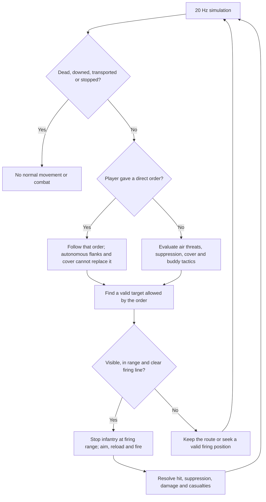
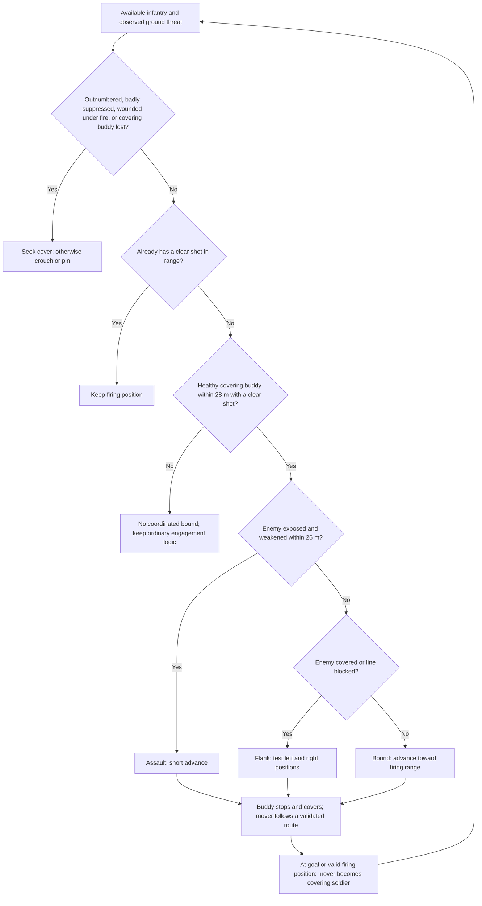

# Rule of War

## What the game is

Rule of War is a desktop real-time strategy game about commanding a military
force across a 3D battlefield. You select soldiers and vehicles, give orders,
capture territory, and spend supply on reinforcements and buildings.

The two opposing factions are **Field Command** and **Iron Front**. The current
build has one combat operation: **Enter Battlefield**, which starts a battle against the
computer on the fixed Forward Base map. **Training Ground** is a separate practice
map for testing those same units and mechanics. Campaign, multiplayer, and alternate
map selection are removed from the player-facing flow while the core game is
refined.

The central idea is to preserve your soldiers while taking ground. Cover,
flanking, retreat, medical support, and a steady supply income matter alongside
firepower.

## How a battle works

1. Start an operation and inspect your base, forces, and nearby terrain.
2. Move soldiers toward command posts and settlements. Scout before committing
   slower or more valuable units.
3. Use cover and supporting weapons to win engagements. Attack from another
   direction when an enemy is protected by cover.
4. Capture command posts to secure territory. Recruit replacements
   and build the facilities you need.
5. Retreat endangered soldiers and use medics to recover wounded infantry.
6. Win by holding every command post for **90 uncontested seconds**, or by
   eliminating the enemy's units and barracks.

## Main mechanics

### Compact command dock

The bottom dock keeps **Barracks**, **Depot**, **Airfield**, and **Orders** within
reach. Click a building tab to slide its recruitment panel open; click the same
tab again, its close icon, or **Escape** to collapse it. Selecting a unit or a
production building on the battlefield opens its matching panel. Escape cancels
an active order or placement first, then closes the panel, then opens the menu.

Unit cards use the same silhouettes as battlefield badges. Hover over a card or
control for its name, description, and keyboard shortcut. The roster retains
health and suppression colours; click to select and double-click to focus.
Scroll over the roster to reach additional units. Scroll within the open panel
to reach more actions or unit details, without changing camera zoom.

The house icon jumps to your base and back (**Home**); the pause icon uses
**Space**. Menu, terrain editor, and effects quality sit at the lower right.
The training shop/tools use the wrench icon or **T**. **F10** hides or restores
the entire HUD.

### Orders and movement

Select a unit or drag a box around several units, then right-click to move or
attack. With combat units selected, left-clicking an enemy also attacks it and
keeps your force selected. A cyan arrow means right-click to move; a red reticle
means left- or right-click to attack. Selection brackets, a gold placement
cursor, and a pan cursor identify other actions. Each cursor has a short hint.
The normal pointer returns over interface panels and menus.

Press **Q** or the **Attack / Advance** button, then click an enemy to focus fire
or clear ground to attack-move. **Escape** cancels this mode. Attack orders
enable firing even if the force was previously holding fire. Attack-move tells
a force to advance while engaging enemies. Patrol
repeats a route. You can queue destinations and create mixed squads for quick
selection: select a tank, medic, support or any other combination, then press
**Ctrl+1-9** to assign the squad. **1-9** selects it; **Shift+1-9** adds it to the
current selection. Squad membership persists in saved games. Vehicles steer and
turn at rates based on their type and size; their turrets aim separately.

Group orders spread units across separate destinations, with wider spacing
for vehicles. Terrain, water,
buildings, and obstacles affect routes. Transports can load and unload troops;
bridges provide land routes across water.

The airfield also recruits an unarmed **UH-1Y Venom** for **24 supply**. It carries
**12 soldiers** using the troop carrier's controls: select it and press **L** to
load nearby troops, or select infantry and right-click it. Right-click to fly;
**U** lands and unloads on clear ground. Soldiers remain aboard until touchdown.
Water, buildings, vehicles and steep ground block landings. **R** returns to the
airfield; low fuel triggers an automatic return. Passengers and pending landings
persist in saves. Hueys and Apaches share the two helicopter pads.

### Cover, flanking, and suppression

Cover reduces incoming direct-fire damage when an obstacle sits between the
shooter and the target. Hard cover offers more protection than light cover.
An attack from the side can bypass that protection. Explosives are less affected
by cover.

Soldiers choose reachable slots on the protected side of walls, sandbags, and
surviving houses. Nearby visible threats can trigger this before the soldier takes
damage. Move and attack-move orders look for protected cover within eight metres of
the destination and reserve it before arrival. Soldiers settle there even when
no enemy is firing. Automatic reactions favour cover near the ordered point
when it is close enough to reach, rather than stopping at cover near the start.
Slots are reserved separately so soldiers do not pile into one spot. Once
settled, a soldier stays in cover through pauses in firing while a local threat
remains. Flanking or destruction makes it reconsider the position. Direct move
and retreat orders override automatic shelter; queued attack orders are retained.

Infantry falls back from a visible threat under heavy suppression or when badly
injured, and keeps its queued attack objectives. It can change heavily suppressed
or blocked firing positions and take nearby buildings when idle and threatened.
Direct move and retreat orders override these automatic decisions.

Incoming fire builds suppression. Suppressed soldiers move and fire less
effectively; pinned soldiers cannot capture territory. Suppression fades when
the soldier is out of fire. Infantry can seek nearby cover during combat while
keeping its queued attack objectives.

For example, one soldier can keep a defender under fire while another moves
around the obstacle and attacks from a clearer angle.

Nearby armed infantry coordinate fire and movement when they see a threat. One
soldier holds a firing position while a partner bounds forward or flanks a defender
in cover. They use local sight and nearby friendly strength to choose a move;
losing the covering soldier cancels the advance. An attack stops the advance as
soon as the ordered enemy is within weapon range and there is a clear shot. A
blocked shot calls for another angle, preserving distance instead of charging
the enemy. Heavy suppression, injury or being badly outnumbered makes soldiers
seek cover or hold low instead of chasing their target.

This applies to both teams. Explicit move, retreat and hold-fire orders override
these plans. Selected-unit details show the current tactical role. Plans and
remaining orders survive save/load.

### Retreat and medical support

Retreat sends a soldier toward a friendly barracks or field hospital. It moves
faster and takes less incoming damage, but stops shooting and capturing.

Assault, sniper, and support infantry can become wounded instead of disappearing
immediately. A medic has **20 seconds** to reach and treat a wounded soldier.
Treatment takes time beside the patient. Nearby idle medics seek wounded soldiers
automatically.

### Supply, recruitment, and construction

Supply pays for new units and construction. Both factions receive exactly
**1 supply every 5 simulated seconds** (12 per minute), with no AI bonus.
Mines and settlements do not stack passive income. Pausing stops the clock,
and saving preserves its progress. Initial supply remains unchanged.

Each new operation starts with a mirrored six-facility base for each faction:

| Facility | Purpose |
|---|---|
| Barracks | Recruit infantry and provide a retreat destination |
| Supply mine | Base supply facility; income follows the fixed faction clock |
| Vehicle depot | Produce ground vehicles and support weapons |
| Field hospital | Support healing and retreat |
| Watchtower | Help observe and defend the base |
| Airfield | Produce and support aircraft |

Commanders and support soldiers construct the facilities allowed for their roles.
Commanders build bridges between two dry banks; support soldiers can deploy machine
gun nests. Recruitment and construction take time, so protect the units and
facilities involved.

### Forces and their roles

| Force | Main role |
|---|---|
| Assault | Take ground with a standard rifle |
| Sniper | Engage distant infantry with a slow-firing scoped rifle |
| Support | Rifle, shoulder-fired anti-air and field construction |
| Commanders | Lead and construct command facilities |
| Medics | Heal and rescue infantry |
| Battle tanks | Provide mobile direct fire |
| Support guns | Deliver longer-range fire after setting up |
| Rocket artillery | Strike distant targets with explosive fire |
| Anti-air vehicles | Counter aircraft |
| Troop carriers | Move infantry |
| A-10s and helicopters | Provide air support and airborne capabilities |

Weapons differ in range, accuracy, reload time, and blast size. Some support
weapons must stop and set up before firing. Direct attack orders keep their chosen
target while moving into range or waiting for visibility; attack-move still
engages nearby enemies automatically.

The **A-10 Warthog** taxis to the runway, takes off and climbs to about
**72 metres**. Right-click a ground target or use **Q** for a cannon strafing
sortie. It lines up a descending pass and fires a 1.2-second, 60-round stream
from its seven-barrel nose cannon, with fast tracers, small impact sparks and
dust, and a rotary-cannon sound. Each pass fires one uninterrupted 1.2-second
burst, with one audio cue. Hits flash and throw ricochet sparks and small debris
from the armor surface; misses kick up ground dust. It carries no bombs. The aircraft then climbs
away, rejoins the runway, lands, taxis to its reserved stand, refuels and rearms.
**Stop/Hold** recalls a flying A-10. Queued sorties begin after servicing;
destinations outside the safe fuel radius are rejected.

Each airfield has **two A-10 stands and two helicopter pads**. Aircraft keep their
stand reservations while away; fixed-wing takeoffs and landings share one runway.
The entire base uses an expanded layout, including resized barracks, depot,
hospital, hangar, control buildings, service roads and perimeter. The runway is
about 244 metres long after the compound scale reduction, with separate
taxiways at both ends. Returning A-10s take
priority over queued departures. Turns, banking, climbs and descents ease in
gradually, with a continuous final approach and a steady circle when waiting.
The A-10's fuel allowance covers the longer airfield circuits.
Helicopters accept movement, attack and patrol orders, take off and land vertically,
and burn fuel while flying or hovering. Low fuel overrides their orders and sends
them to their reserved pad. After refuelling they remain parked until ordered out.
Both models use reference-shaped fuselages, cockpit frames, engine vents,
access panels and service details. The A-10 has a compact canopy and tapered
wings; the Apache has flat window panes and painted cockpit roof sections. The A-10 has detailed turbofans, straight wings,
twin tails and a spinning nose cannon. The Apache-style helicopter has tandem
cockpits, a sensor turret, weapon wings, a radar dome and articulated rotor links.
Selected aircraft show their fuel, altitude, flight activity and cannon ammunition.
Aircraft recover at another owned airfield with a free compatible stand if their
home is destroyed.

The active operations focus on land and air warfare;
naval units and ports are retired.

### Capture, visibility, and destruction

The first two minutes are a deployment phase: recruit, scout and establish cover
while captures are locked for both factions. Then armed infantry must secure a
command post or settlement for 25 uncontested seconds. Extra troops do not speed
up the clock. Any opposing ground unit contests the zone, including armour.
Retreating, wounded, pinned, embarked, and airborne units cannot capture.
Enemy-held posts need 25 seconds to neutralize, then 25 seconds to secure.
Abandoned progress decays; opposing claimants must undo existing progress.
Hold every post uncontested for 90 seconds to win. Any enemy incursion interrupts
that hold. The AI assembles an assault group and keeps guns and support behind it.
Training skips the deployment timer. Tanks reload for 4.5 seconds between rounds.

Fog of war hides enemy soldiers and vehicles outside current sight. Terrain,
scenery, buildings and the minimap stay visible at every zoom level; clear-air
haze is capped at 8% opacity so it cannot wash out the battlefield.
Sun shadows follow the camera's visible ground through pan and zoom. Field rows,
dry patches, tramlines and headlands reuse existing materials for surface depth.
Household plots have varied fences, raised beds, benches and timber stores, with
garden paths and worn ground at the walls. The existing pieces follow the terrain
and leave entrances clear. Grass and road textures use finer scales, while wall
and roof textures stay aligned with each house as it turns.
Sight distances scale relative to 512 metres, capped at 1–4 times the authored
radius. The countryside and GIS maps use their shorter dimension; other maps use
their longer dimension. The 2048 x 1024 countryside therefore keeps twice the base
sight radius for both factions. Shooting range is independent of sight distance.
Selecting a unit shows its maximum sight circle; buildings, hills and vegetation
can hide enemies inside it. Friendly spotters share their contacts.

Spotting traces from the observer's eye height to the target. Intact house wings,
facility buildings and terrain ridges obstruct sight; courtyards and collapsed
houses remain open. Aircraft can see over obstacles when their altitude allows.
Hedges, shrubs and woodland accumulate concealment using the existing seeded
vegetation, independently of camera position or graphics detail. Taller vehicles
can see over low growth. Moving or recently firing units are easier to detect
through partial concealment; neither reveals a unit through a solid building or
hill. Vegetation conceals without stopping bullets. Terrain also obstructs direct
fire; indirect artillery retains its ability to fire over obstacles.

| Role | Sight on 1024-metre maps | Weapon radius |
|---|---|---|
| Assault infantry | 64 metres | 45 metres |
| Support infantry | 192 metres | 32m rifle / 160m AA |
| Battle tanks | 144 metres | 100 metres |
| Sniper | 224 metres | 110 metres |
| Anti-air | 224 metres | 200 metres |
| Support guns | 288 metres | 200 metres |
| Rocket artillery | 420 metres | 310 metres |
| A-10 Warthog | 200 metres | 200 metres (forward cannon pass) |
| Helicopter | 256 metres | 85m machine gun / 120m rockets |
| Medic | 80 metres | Unarmed |

Infantry can enter friendly or neutral houses and facilities. Right-click the
building or press **G** to find one nearby. Press **U**, move, or retreat to leave.
Town and training houses are one storey tall on matching **10 x 10 metre plots**.
Square, L, H and straight plans provide 15, 13, 17 and 9 windows respectively.
Their courtyards and recesses remain open for movement and sight lines.
Every soldier reserves a separate window, including while approaching the building.
Soldiers route around the exterior to the front door and walk across the threshold;
leaving follows the door route too. Walls have real door and window openings.
A house or facility occupied by your own infantry has a transparent roof and
wall cutaway. Enemy occupants stay hidden inside, including with fog disabled;
they can still fire and take damage through windows. Each house switches independently; the roof becomes opaque after
the occupants leave.
Opposing forces cannot share a house. Occupants move to free windows with a clearer
line to visible targets and stop shooting during the move. Buildings block direct
fire, while artillery can arc over them.

House health scales with the occupied floor area. Facilities have their own health.
Walls chip, roof panels break and rubble accumulates through eight procedural
damage stages, with the shell standing until its health is exhausted. Saved
integrity reconstructs the same damage. Facades use ochre, sage, blue, rose, ivory,
brick and timber, with terracotta, slate and green roof variants using existing
textures. Ordinary shells take multiple hits to collapse them; a projectile exceeding their
remaining health can still destroy them in one shot. Collapses injure and evacuate
occupants. Tank shells, artillery, rockets and cannon bursts damage an area, with damage
falling off toward the edge of the blast. Terrain damage is separate: only heavy
artillery and rocket impacts on dry ground can form craters. Armour and
structure hits do not dig underneath the target, and repeated hits on one crater
do not deepen it.

Explosions can destroy cover, leave wrecks, and make craters in dry ground.
Town houses retain individual damage and collapse into rubble. Collapsed house
footprints stop blocking movement and providing their former cover. A town's
ownership and capture still apply to the whole settlement. Battlefield damage
persists in saves.

Destroyed tanks retain scorched hulls, tracks, tilted turrets and guns. Transports,
rocket launchers and aircraft leave their own recognisable wrecks; facilities
leave broken walls, collapsed roof sheets and their foundations. Crates splinter
into wood and sandbags spill onto the ground. Flying fragments use the source
object's parts and materials, tumble under gravity, bounce and settle.

Blasts have a brief ignition flash, outward dust and rising smoke. Rocket impacts
and vehicle destruction use animated fireballs that roll into turbulent smoke,
with a rising stem and irregular cap. The supplied explosion and smoke sequences
replace the former rounded smoke meshes. Heavy blasts develop broad, rolling
caps above narrow smoke columns and dissipate over roughly seven seconds. Vehicle fuel
fires fade over time while their wrecks remain. Splash damage diminishes toward
the blast edge, and explosions can hit a facility's outer footprint. Vehicle
wrecks block their hull footprint and give directional hard cover; collapsed
facilities leave passable rubble. Wreck shape, scale, orientation and fire age
are preserved in saves. Older saves with generic wrecks remain compatible.

## The battlefield

**Forward Base** is a fixed **2048 x 1024 metre** proving ground. The wider map
leaves room for armour, recon, support weapons, and flanking without revealing
the opposing base at the start. The terrain layout is deliberately defined:
rolling ridges, central lowland, a shallow drainage basin, connected dirt
routes, field boundaries, woodland, and one connected central town with three command posts.
Starting an operation uses this layout every time; the random terrain generator
does not create the playable map.

New operations start with three assault soldiers, a sniper, a tank, a support
gun, one troop carrier, commander, support, medic, and the six-facility base per
faction. The player starts with 80 supply. Both factions receive the same fixed reinforcement income:
1 supply every 5 simulated seconds.

Save/load, preferences, and the terrain editor remain available. Campaign and
network infrastructure are retained for compatibility and developer checks,
but are unavailable as alternate player modes.

## Training Ground

Choose **Training Ground** from the main menu to enter a fixed **1024 x 1024 metre**
practice map. It has four clear firing lanes with ticks every 25 metres, a
staging area, prepared cover, a capture point, a rear hill, and a small water
basin for bridge practice. Four neutral practice houses sit between the third
and fourth lanes, beside staging: Square (15 windows), L (13), H (17), and
straight (9), each one storey on the same 10 x 10 metre plot. Right-click a house with infantry selected to
enter, press **G** for a nearby building, and **U** to leave. Use attack orders to
test building damage; **F2** restores destroyed houses along with the whole range.
The range has no enemy commander or victory timer;
destroying all targets does not end the session. Fog starts off.

You start with **5,000 supply**, five support soldiers, and the usual six base
facilities. The **Buy Units** tab buys any active infantry, vehicle, support
weapon, or aircraft at its normal supply price and deploys it immediately at
staging. Aircraft deploy at a free matching airfield stand. Each purchase is selected automatically. Normal recruitment and
construction remain available for testing their timings. Extra commanders are
free in training because they have no ordinary recruitment price.

1. Buy a unit from the shop. Scroll the command panel to see more units.
2. Right-click a target to fire. Purchased units hold fire until given an attack
   order; **E** enables automatic fire and **H** restores hold fire.
3. Open **Test Tools** to place infantry, armour, or air targets, or to add
   sandbags, walls, and crates. Left-click clear ground to place; hold **Shift**
   for repeated placement. Right-click or **Escape** cancels placement.
4. Enable **Return Fire** to test cover, suppression, retreat, and medical
   support. Targets use real unit health, weapons, and armour, but stay in place.
   Red-and-white markers identify them.
5. Use **Reset Targets** to restore all target positions and clear shot statistics.
   **Clear Targets** removes them temporarily; resetting brings them back.

The HUD counts friendly shots, damaging hits against targets, and health damage
actually dealt. **Refill Supply** restores 5,000 supply. **Heal Selected** repairs,
revives, and refuels selected units. **Wound Selected** downs eligible rifle,
sniper, and support soldiers so a nearby medic can demonstrate rescue. **Fog**
lets you test sight ranges. Scroll the tools panel for these controls.

Press **T** or click **Range Shop / Tools** to switch between range tools and
normal unit orders. **Space** pauses the simulation; tools still work while
paused. **F2** resets the entire range, including purchased units, cover, and
terrain damage. **F5/F9** save/load training in `native-training.json`, separate
from the battle save. **Continue Training** appears in the menu after saving.

## Art direction

### Overall look

The direction is **grounded, stylized military realism**, viewed from a raised
strategy camera. The battlefield should feel believable while keeping soldiers,
vehicles, buildings, and useful cover easy to recognize at a distance.

The current art is made from procedural 3D geometry, materials, and animation.
Each infantry entity is one soldier, including medics and support. Rounded
boots, fitted webbing, curved shoulders, and a compact pack soften the model.
Its detail comes from clear shapes, proportion, surface variation, lighting,
and motion.
Armed soldiers hold their rifles with two bent arms; both hands follow the
weapon through movement, aim and recoil. Walking knees bend behind the thigh,
boots remain level, and the supporting foot stays planted.

### Colour and lighting

Use muted greens, browns, dusty earth, weathered metal, and subdued masonry.
Faction colours identify ownership. Warm lighting, soft shadows, ambient
occlusion, and restrained bloom give forms depth. Bright flashes and tracers
draw attention briefly during combat.

Destroyed airborne helicopters break into a burning airframe, retain forward
momentum, spin and fall under gravity. Ground contact produces a larger explosion
and a persistent wreck. A saved game preserves a crash already in progress.

### Terrain and settlements

Surface textures use filtered mip levels to stay stable as the camera moves
and zooms. Terrain has smooth slopes, varied soil, irregular trees and rocks, and water
that follows shorelines. Forest placement stays fixed as the camera moves.

Towns use detached houses along winding dirt lanes, with varied orientation,
setbacks, one-storey Square/L/H/straight plans, and materials. Each uses a
matching 10 x 10 metre plot. Doors and buildings should share a
believable scale with infantry and vehicles. Damaged masonry and persistent
rubble show the history of a battle.

### Units, facilities, and animation

Give each unit a distinct silhouette. Infantry uses recognizable helmets,
equipment, and weapons. Vehicles use features such as sloped armour, tracks,
wheels, hatches, stowage, and exhausts. Facilities communicate their jobs through
their shape and equipment; the airfield includes a runway, hangar, apron,
control tower, and fuel stores.

Movement and combat should be visible in the models: walking, running,
crouching, aiming, recoil, and medical work. Vehicle wheels, turrets, barrels,
and helicopter rotors animate too.

### Combat effects, sound, and interface

Visible tracers, shells, and arcing rockets connect weapons to their impacts.
Shot origins come from sockets tagged directly on the rendered barrels; scale,
aiming and recoil apply to both the barrel and socket. New rounds are oriented
along the socket on their first frame, avoiding a vertical streak below the gun.
Explosions combine a short flash with debris, ground dust, and longer-lived
smoke. Distinct weapon sounds, footsteps, engines, and treatment cues help the
player understand activity across the battlefield.

The interface resembles an operational briefing: dark panels, pale text, muted
gold accents, faction insignia, and condensed headings. A minimap, unit cards,
health bars, command-post indicators, order markers, and status displays make
the battle readable. Cover, suppression, wounds, and queued orders need clear
feedback.

## Current scope

The game is an evolving playable native implementation. Cover, suppression,
retreat, medic rescue, production, terrain editing, and saves are implemented
in the current core battlefield.

Individual soldier rescue dragging, obstacle vaulting, ammunition logistics,
fully walkable building interiors, detailed armour penetration, and complete world destruction
remain future work. Infantry uses an authored skinned Blender character with class equipment.
Vehicle geometry and audio layers are procedural; voice work remains future art work.

## Getting started

Double-click **Play Native.cmd**, or run `cargo run --locked` from this folder.
Choose **New Battle**. Start a fresh battle to use the revised map and
starting forces and a connected town joining the H, L and E districts. Older saves keep their town layout;
base foundations are repaired when loaded.

| Control | Action |
|---|---|
| Left-click / left-drag | Select / box-select |
| Right-click | Move or attack |
| Click an objective flag | Show its 32 m capture radius |
| Q | Attack-move |
| Shift + right-click | Queue a destination |
| R | Retreat |
| X | Stop |
| G / U | Enter nearby building / leave building or unload |
| Ctrl + 1-9 / 1-9 | Assign mixed squad / select squad |
| WASD / middle-drag | Pan the camera |
| Mouse wheel / C | Zoom / focus selection |
| Space | Pause or resume a solo operation |
| F5 / F9 | Save / load |
| Escape | Open the menu |

See [native/README.md](native/README.md) for full controls, save locations,
and editor instructions. See [MODDING.md](MODDING.md) for the
code structure and extension points.

Occupied houses keep their roofs translucent and hide only the walls facing the
fixed camera. Town streets and
yards leave room to fight inside objective capture zones.

The base compound is now 20% smaller in each horizontal dimension, with barracks,
hospital and supply grouped beside the vehicle depot. Service drives meet the
facility entrances. Blue unit symbols identify Field Command; red symbols
identify Iron Front, and markers only appear for units visible to the player.

The bottom command panel has permanent **Infantry / Barracks**, **Vehicles / Depot**
and **Aircraft / Airfield** tabs. Each selects an owned production building and
shows its compatible recruits. Click unit cards to queue up to five units per
building. Recruits train in order; separate buildings work independently. The
panel shows queue counts and progress, and **Cancel Last** refunds supply.
Aircraft queued for production reserve compatible stand capacity.

The A-10 cruises at 40 metres per second and strafes at 36. It fires one continuous
60-round burst in about 1.2 seconds from farther away, then immediately pitches
up and banks onto an escape leg. It breaks off before crossing the target even
if it cannot obtain a firing alignment. This also applies on the training range.


## Infantry classes and aircraft countermeasures

Barracks recruit four infantry classes: **Assault**, a standard rifleman;
**Sniper**, a scoped rifle specialist with 110m weapon range and 4.5s reload;
**Medic**, the existing unarmed healer and casualty rescuer; and **Support**,
a rifleman carrying a shoulder-fired anti-air launcher. Support also retains
field construction, repairs and emplacement tools. Commanders remain starting
leadership units, and gun emplacements are built equipment.

Support locks a visible airborne enemy within 160m for 1.25 seconds before
launching. It cannot launch from inside a building, in transport, while pinned,
or under hold-fire/move/retreat orders. An explicit attack order takes priority.
Missiles track their designated aircraft; they do not explode on ground units.
The launcher reloads for 12 seconds while the rifle remains available against
ground targets. Snipers and ordinary rifles cannot shoot airborne aircraft.

Each missile rolls once on launch for a **60% hit chance**, reduced to
**20% against active flares**. Aircraft therefore evade 40% of ordinary missiles
and 80% with flares. Every confirmed hit destroys the aircraft regardless of
remaining health; misses visibly pass clear of the airframe and airburst. The A-10 and helicopter each carry **three flare
salvos**, automatically deployed when a missile launches. Protection lasts 3s;
the dispenser has a 12s cooldown. Servicing at the airfield restores all salvos.
Flare counts and cooldowns appear in aircraft details; support shows launcher
readiness. Both factions and the training range use these rules. Rolls, locks,
missiles, flare stocks and timers persist in saves and use the deterministic
simulation, so reloading a save does not reroll an interception.

Infantry use the existing skinned Blender rig with class equipment attached to
its bones: a scoped, extended sniper rifle and camouflage shoulder drape; medical
crosses and unarmed medic work; an olive support launch tube that moves from the
pack to the shoulder, with matching muzzle and arm poses. The 7,000-triangle
limit includes the equipment. Legacy rifle/recon/engineer save IDs are retained
as assault/sniper/support, preserving orders and squads.

Menus and command buttons use embedded, nine-sliced enamel-and-metal raster art
with worn brass edges, native text and hover/pressed states. The original files
and generation prompts are in `native/assets/ui/`.

Unit symbols are shared between overhead markers, recruitment cards, roster and selection: assault uses three cartridges, medic a plus, support an open wrench head, sniper a scope reticle. Vehicles use distinct tracked silhouettes, with separate A-10 and helicopter silhouettes. Blue and red preserve faction identification without revealing hidden enemies.


### Troop carriers and helicopter combat

A carrier holds **six soldiers**. Select infantry and right-click a friendly
carrier to board, or select the carrier and choose **Load Troops [L]** to collect
nearby infantry. Soldiers walk to it and reserve available seats. Selected-carrier
details show the passenger count. Move it to the drop-off point and press **U**
to unload; soldiers use separate clear positions outside its hull. A new move
order cancels a soldier's pending boarding order. Wounded soldiers cannot board.

Helicopters accept direct attack and attack-move orders. They use five-round
machine-gun bursts against infantry and two-rocket salvos against vehicles and
facilities, approach from standoff range, and break away between attacks. They
prioritize observed anti-air threats unless given a specific target, evade incoming
missiles and return for fuel or severe damage. Existing flare and fatal-hit rules
still apply. Move and hold-fire orders override automatic attacks.

Infantry reacts to visible hostile helicopters within its local threat area.
Available support soldiers hold position to lock and launch MANPADS; other soldiers
seek nearby shelter or cover, or withdraw from exposed ground. Explicit movement
orders remain authoritative. Rocket artillery, MANPADS and helicopter rockets leave
broader, longer-lived pale exhaust trails, sampled along their flight paths.

New battles join the three former towns into **one 52-house town**. The three
neighbourhoods share distributor streets, sidewalks, infill housing and three
capture squares. Start a new battle for this layout; existing saves retain their
buildings, damage and occupants. Training retains its practice houses.


The ground blends the supplied grass, soil and gravel textures with soft, uneven
boundaries. Cultivated edges and road shoulders fade into meadow, and woodland
uses clustered planting with varied tree height, rotation and colour. These
material changes also apply to training and existing saves.

## Combat balance and infantry decision guide (22 October 2026)

Vehicle prices are **20 supply for a battle tank**, **24 for a support gun**, and
**16 for a troop carrier**, for both factions and all production menus. Support
guns have a six-second reload, in addition to their aiming and setup time. A
successful support-gun hit on a ground vehicle rolls independently for a **20%
critical**: critical damage equals the victim's maximum health before cover,
distance falloff and retreat protection. Ordinary hits deal **0.75** before those
modifiers; a fresh vehicle survives an ordinary hit. Accuracy is a separate roll,
so 20% describes hits, not all shots fired. Other weapons keep their damage rules.

Rifle and sniper damage against house integrity and facility health is reduced
by **90%**. Their damage and suppression against soldiers remain unchanged.
Battle tanks can shoot while advancing on attack-move or patrol, using their
independent turret. A direct attack still stops at a firing position. Explicit
move-only orders continue to hold weapons, and X stops both movement and fire.

Enemy window occupants require a living, untransported friendly infantry observer
within its sight range and with an unobstructed firing line to that window. Tanks
and aircraft alone cannot discover occupants, even with fog disabled. Spotting
updates immediately when the observer leaves, is downed, dies, boards a carrier,
or loses its view. Knowledge is shared by the observer's faction. Hostile interior
models and occupant counts remain hidden from the player. A deliberate player
attack on a chosen house bypasses occupant spotting, because the house itself is
the target. Automatic vehicle fire never selects a town house for demolition.

Natural rock outcrops use deterministic terrain-noise clusters, larger asymmetric
boulders, smaller fragments and varied stone tones. They use the existing scenery
worker and chunk batches, including at overview distance. Roads, house entrances,
base aprons and training lanes stay clear. These rocks are visual scenery; they
do not add cover or collision rules.

### Decision layers and timing

Infantry uses explicit rules in the authoritative simulation. It does not learn
from previous battles. Both factions share the local combat, suppression, cover,
garrison and medical logic. Only the computer faction runs the strategic planner.
Random weapon rolls and tactical state are saved, so loading does not reroll them.

| Layer | Frequency | Responsibility |
|---|---|---|
| Simulation | 20 times/second | Orders, movement, weapon targeting, impacts, window positions |
| Cover search | 5 times/second | Nearby protection and idle medic rescue routes |
| Fire and movement | 2 times/second | Air threats, danger checks, buddy roles, short bounds and flanks |
| Emergency manoeuvres | Once/second | Withdrawal, lateral escape and opportunistic shelter |
| Medical support | Once/second | Choose a patient and heal or revive |
| Computer strategy | Every 5 seconds | Rally, advance, second line and recruitment |



### Orders have priority

- **X / Stop:** cancel movement, targets, windup, launcher lock and local tactical
  actions; latch hold-fire until a new order or E / Auto Engage.
- **Move-only:** reach the destination without firing; still subject to physical
  collision and reduced speed from suppression.
- **Attack-move / Patrol:** stop infantry to engage a visible reachable target,
  then continue the original journey when no target is available.
- **Attack a specific unit or house:** keep that target; a nearer enemy does not
  replace it. Walk only far enough to get a valid firing position. Temporary loss
  of sight holds the order rather than tracking an unseen enemy.
- **Board / Enter building:** use the reserved carrier seat or the clicked house
  and doorway, with combat and old tactical actions cancelled during entry.
- **Retreat:** leave combat and route to the friendly base perimeter; retreat
  increases movement pace and reduces incoming damage. The unit returns to attack
  stance once it arrives.
- **E / Auto Engage:** release Stop and the manual reservation so the local AI can
  make cover and manoeuvre decisions again. Default attack stance can fire even
  when a manual reservation prevents autonomous repositioning.

### Seeing and choosing an enemy

The faction shares sight from living, non-downed units outside transports. The
maximum radius is filtered by eye-height sight lines through terrain and buildings,
and by the thickness and height of vegetation. Garrison observers see out through
their reserved window facing. Movement and firing reduce partial concealment.
Sight scales with map size independently of weapon reach. Enemy garrisons still
require a living infantry spotter; only friendly interiors appear in the view.

An explicit attack target takes priority. Otherwise infantry engagement prefers
an in-range contact with a clear firing line, then the closer contact. The combat
pass fires at the nearest valid target matching its order or current tactical
assignment. Ground rifles and sniper rifles exclude airborne targets. Support
uses its separate launcher against aircraft and its rifle against ground targets.

Infantry fires only when its target is visible, alive, hostile, outside a carrier,
within weapon range and reachable by the firing line. Moving tactical roles do not
fire while still moving. Hold-fire, retreat, move-only, boarding, medical work or
launcher animation may prevent normal rifle fire. Suppression at **0.85 or above**
prevents normal fire. Once aimed and reloaded, accuracy is the class hit chance
multiplied by `1 - suppression * 0.5`. A projectile still takes time to arrive.

### Fire and movement: one mover and one covering soldier

The planner considers nearby observed ground contacts, friendly armed units
within **28 m**, enemy weapon reach, health, suppression and current protection.
It only assigns manoeuvres to available, healthy-enough armed infantry without a
manual reservation. It avoids moving a quiet, idle defender out of position.



Covering-buddy selection favours a stationary soldier already protected; snipers
receive a small preference for this role. The buddy must be alive, below **0.4
suppression**, at least **45% health**, in range and able to shoot the same enemy.
It cannot already be moving tactically, pinned, reserved by the player, or ordered
to attack somebody else.

Bounds advance at most **8 m**. A flank tries positions roughly **10 m** to either
side, with a cover slot within **4 m** where possible. An assault is considered
when friends are at least as numerous as threats and the enemy has at least **0.65
suppression** or less than **35% health**. Goals cannot be impassable, too close to
another friendly reservation, within **6 m** of another observed defender, or
closer than the desired weapon standoff. These are bounded local options, not a
long-range encirclement planner. Failed options wait two seconds before retrying.

```text
                 ENEMY IN COVER
                       E
                       ^
                       | covering fire
                       |
           [cover]      A              B' [side position]
                       |              ^
                       |              | short flank
                       +---- B -------+

   A stays and fires. B moves without firing.
   B stops as soon as it has a valid firing position.
   If A is lost or suppressed, B reassesses and seeks protection.
```

### Suppression, danger and cover

Near-miss trajectories create a threat warning lasting **2 seconds**. Impact
pressure adds suppression even when damage misses: normally **0.24** for small
arms and **0.5** for explosive impacts, reduced by protection. Suppression ranges
from 0 to 1, and recovers by **0.012 per tick** after one second without new impact
pressure. Movement slows to **55%** at 0.45 suppression and **22%** at 0.8.

A soldier seeks protection if local enemies outnumber friends by at least two,
suppression reaches **0.65**, or it is under fire below **35% health**. A mover
also reassesses when its covering partner dies, becomes downed, or reaches 0.65
suppression. A protected stationary soldier stays put and becomes Pinned rather
than zigzagging. Otherwise it searches for an unoccupied cover slot within **8 m**.
With no safe slot, it stops and crouches instead of chasing a kill. Pinned is a
tactical waiting state; the normal firing threshold is still 0.85.

The secondary emergency pass can retreat about **10 m**, move about **5 m**
sideways to escape blocked fire, or use nearby shelter. General cover search can
use a destination near the soldier's order, then a nearby slot. Unproductive cover
plans expire and back off for **5 seconds**, restoring the original route.

Protection is directional: an obstacle must lie between shooter and soldier.
Sandbags, walls, crates, rubble, wrecks and buildings supply different cover levels.
Light cover passes **70%** of bullet damage; strong cover passes **38%**. Strong
cover passes **75%** of explosive damage. Trees, shrubs and decorative rocks do
not currently supply cover. Cover never guarantees safety or prevents every hit.

### Helicopters, medics and classes

Visible hostile helicopters within **105 m** trigger the air-response pass for
autonomously available soldiers. Ready support infantry with a clear line holds
position for air defence. Other infantry tries shelter within **14 m**, seeks
cover, or moves away if exposed. Manual orders still take precedence.

The support launcher independently checks a visible aircraft within **160 m**,
clear line, stance, reload and suppression below **0.8**. It locks for **1.25 s**,
fires, then reloads for **12 s**. It cannot launch while inside a building or
transport. Aircraft deploy available flares; the launch roll is **60%** hit without
active flares, **20%** with them. A hit is fatal; a miss passes clear. These are
separate odds from the support gun's new ground-vehicle critical roll.

| Class | Ground role | Particular behaviour |
|---|---|---|
| Assault | Standard rifle combat, 45 m range | Main advancing and capturing infantry |
| Sniper | 110 m rifle, 4.5 s reload | Longer standoff; preferred covering buddy when suitable |
| Medic | Unarmed | Unreserved idle medics seek downed allies within 18 m, then heal within 3 m |
| Support | 32 m rifle plus anti-air launcher | Air defence; also retains engineer tools |

Healing selects the nearby ally with the lowest remaining health. A medic revives
a downed soldier to **35% health** after treatment time; untreated downed assault,
sniper and support soldiers expire after **20 s**. Stop prevents treatment, and
movement or another active order prevents an idle medic's automatic treatment.
Casualty rescue and normal healing are different from offensive buddy tactics.
A manually positioned medic can still treat nearby allies after arriving, but
needs E / Auto Engage before independently detouring to a more distant casualty.

### Buildings, routes and objectives

Entering a house reserves one window in the selected lot. Infantry approaches the
front door, crosses it, then moves to its firing position. One soldier owns each
slot. Inside, window selection favours a free outward-facing slot toward a threat,
but changing windows takes time and prevents fire until ready. Buildings block
shots through their other wings and neighbours. A collapsing house releases or
damages occupants through the destruction rules.

Direct attacks route to a firing position, not the enemy's feet. The router tests
short lateral corrections before candidates around about **94% of weapon range**.
Routes use terrain-weighted A* with geometric building clearance, then shorten
only collision-clear segments. Replanning is staggered, failed paths back off,
and lost routes are retried without pretending the soldier reached its goal.
Group destinations use formation spacing and nearby cover; moving allies use
soft separation. This is not a full crowd/navmesh solver.

The computer planner runs every five seconds. It picks the nearest uncaptured
objective from its base and stages units at a rally point. Assault infantry and
battle tanks advance once three assault/sniper soldiers are gathered, or an
assault soldier is already near the objective. Snipers, guns and support establish
a second line **38–58 m** back. Idle recruitment fills missing medic, support and
sniper roles, then recruits assault, up to a 24-unit force check and available
funds. It does not currently build a sophisticated combined-arms production plan.

Objectives unlock after the **120 s deployment**. Armed, unsuppressed-enough
infantry captures; vehicles can contest but cannot capture alone. Both teams in
the zone contest it. Capturing takes **25 s**, and holding all three objectives
uncontested for **90 s** wins. The final screen can be dismissed to inspect the
battlefield or used to start a new operation.

The main limitations are simple strategic planning, local two-soldier coordination,
radial shared fog knowledge, and heuristic cover choices. There is no persistent
squad hierarchy, learned tactics or global prediction of future enemy movement.

## Saint-Orne visual demonstration

Open **View Visual Demonstration.cmd** for the opt-in art-direction study. This
uses the actual renderer, rigged soldiers, tank models, damageable house lots and
vehicle wreck logic, in a compact six-house neighbourhood. It has no win condition.
It starts with a clean presentation view and automatically cycles effects; **H**
reveals the ordinary unit interface so soldiers and tanks can receive orders.

The default camera now uses a compressed 25-degree perspective lens, a fixed
45-degree diagonal heading and a fixed elevation. This gives the preferred
semi-orthographic appearance while retaining perspective depth. The battlefield,
training ground and demonstration share the same angle. WASD and map dragging
pan; the wheel zooms. Camera orbit and inspection rotation are disabled. Unit
markers account for the longer lens so they retain a readable size.
The same lens and zoom-coverage calculation now apply from startup, including
dragging, ordinary operations and Training Ground; the old tighter match-only
zoom multiplier has been removed. The strategic globe retains its own controls.

The elevation is now about **50 degrees**, seven degrees lower than the first
pinned-camera pass. Both explosion bakes match this angle. Artillery offshoots
use tapered, irregular smoke wakes that disperse quickly. Vehicle mushrooms
draw smoke inward at ground level and accelerate it up a narrower stem into
the rolling cap. Animated `motion-preview.gif` files beside the editable Blender
scenes let you inspect these effects without starting a battle.

The earlier reference animations are now re-rendered for this camera in Blender
Cycles, with warped volume boundaries, fine ejecta, textured soot and warm internal
illumination. The solid smoke-lighting envelopes have been removed to avoid the
rounded, separate-ball appearance. They retain HDR brightness until
the game's final tone map. The vehicle mushroom is slightly larger. Large blasts
also send out a brief expanding 3D pressure sphere, which subtly lenses the
buildings and terrain behind it. Small shell contacts retain their dust/chips.

The HD pack uses **1024-pixel frames**, newly rendered at 192 Cycles samples from
16-bit sources. A shadow-precise HDR encoding preserves dark smoke gradients
that were reduced to a few levels in the older textures. The baseline linear
sun/sky/fill colours and direction are recorded in
`assets/Realistic_Explosion_VFX/lighting.json`. The afternoon world treatment
warms and strengthens direct sun while reducing fill; it retains the baked light
direction and grades the complete HDR scene together. Image handedness is corrected for
the two coordinate systems; the depth slices stay aligned under perspective at
close zoom. The game opens maximized with a 1920×1080 starting resolution.

**B** changes between the existing lighting/material treatment and the new warm
sunlight, cool ambient fill, neutralised architecture textures, muted roof palette
and richer grass treatment. The geometry and effect motion stay the same for this
comparison. The street has footways, garden fences with clear entrances, textured
hedges, garden trees, raised vegetable beds, a bench, poles and utility wire.
Dressing is batched and decorative; it does not introduce a new collision system.

| Control | Action |
| --- | --- |
| 1 | Small shell impact: brief grounded dust and ballistic chips |
| 2 | Artillery: bright initial core, fine outward ejecta and low dispersing smoke |
| 3 | Vehicle destruction: taller plume, real vehicle wreck and persistent burning |
| Enter | Repeat the selected effect; repeated vehicle bursts simulate secondary explosions |
| V | Compare the selected effect at 1x, 2x and 3x side by side; return to the ordinary study |
| 4 / 5 / 6 | Preview 1x / 2x / 3x alone |
| R | Restore houses, vehicles and patrols, clear damage, reset the camera centre |
| B | Compare lighting and material treatment |
| H | Toggle ordinary unit controls and unit markers |
| Auto button | Start/stop the eight-second effect sequence |
| Space / F6 | Pause / change particle quality |

Fire and smoke are rendered offline in Blender from the fixed game angle, with
64 frames per animation. Each animation is split into back, middle and front
depth slabs. The game places them at distinct depths and tests them against
buildings; this approximates partial occlusion without putting a single flat
picture over the whole scene. It is a 2.5D approximation, not a live fluid solver.
Frames interpolate in premultiplied colour space, and each frame has isolated mip
levels so adjacent frames cannot bleed into it at distant zoom levels.

**View Explosion Scales.cmd** starts a size comparison. Left is the current 1x
size, centre is 2x, and right is 3x. The camera fits the larger effects; each uses
the same animation time and debris seed. Auto alternates artillery and vehicle
mushrooms. Press **2** or **3** to choose one, **Enter** to repeat, or **4 / 5 / 6**
to inspect a size alone. Comparison views keep the same camera framing across
sizes; the wheel still zooms and WASD still pans. **V** restores all three sizes
from an isolated view, then returns to the ordinary study on another press.

Scaling multiplies the rendered fire/smoke, fragment sizes and trajectories, and
pressure sphere after their normal size caps. It does not change weapon damage,
blast damage radius, or ordinary gameplay effects. A comparison does not damage
the town. Developer flags are `--visual-demo --demo-scales` and optional
`--demo-scale 1|2|3`.

The vehicle/crash effect uses the mushroom animation; artillery and rocket bursts
use the debris animation. Small tank-shell contacts remain physical dust and
chips. Ballistic debris, ground dust, flashes, scorch marks and wreck fires remain
3D. Low/Balanced/High change texture filtering, debris counts and admission limits;
at most 8/16/24 layered blasts can be active. Missing external animation assets
fall back to the volume renderer. `--vfx-volumes` explicitly selects that fallback.
Starting with `--vfx-quality low` uploads 256-pixel frames (about 128 MiB for
both families). The default Balanced setting uploads 512-pixel frames (about
512 MiB), reducing animation texture memory by 75% from the former default.
High retains available source resolution. Live F6 adjusts
budgets/filtering without triggering blocking texture reloads during play.

Use **R**, rather than repeated vehicle bursts, to restore a fresh target. Saving
uses `native-visual-study.json` so it cannot replace the ordinary battle or range
save. The study remains a separate neighbourhood for review; its chosen palette,
camera and explosion treatment now also apply to the battlefield and range.

Developer captures use `--visual-demo --smoke-test <png> --demo-effect 0|1|2
--demo-age <seconds>`. Add `--demo-baseline` for the original material treatment,
`--demo-orthographic` for a developer projection comparison, `--demo-occlusion
behind|inside|front` for depth checks, or `--demo-duration 60` for a minute of
automatic playback. Reproduction scripts and measured results are under
`.data/battle-bench/check_locked_view.py` and `.data/render-checks/locked-view/`.
Editable Blender scenes, source frames, contact sheets and packed animations are
in `assets/Realistic_Explosion_VFX/locked_view_hd/`; the older `locked_view/`
pack is retained. `View Explosions In Blender.cmd` opens the editable
`explosion_gallery.blend` using the tested portable Blender 4.5.3. Select the
MUSHROOM or ARTILLERY scene, use Numpad 0 for its camera and F12 for a clean
render. Each effect also has a `*_preview.blend`; the `*_locked.blend` files
retain the log-HDR export compositor. Rebuild instructions are in the HD pack's
`README.txt`, using `tools/bake_locked_view.py --hd` and
`tools/pack_locked_view.py`. Developer `--demo-close` starts a close camera view.

### Two explosion shapes

Matches and Training Ground use one spiky debris burst and one fuel mushroom.
Vehicle destruction and crashes use the mushroom; heavy explosive contacts use
the debris burst. Small tank/cannon contacts retain impact particles. Random
seeds vary flying fragments and dust, with a consistent cloud shape and playback
rate for each family. The wide, thin, fat and wind-swept profiles are removed.

Open `View Explosion Scales.cmd` to compare the same two shapes at different
sizes. Press **2** for artillery or **3** for mushrooms, **Enter** to replay,
and wheel to zoom. Size comparison remains available with **V**, **4**, **5**
and **6**. The older `View Explosion Variations.cmd` redirects to this view.

### First photographic material batch

The supplied ten PBR packs now cover short grass, dry grass, earth, asphalt,
gravel, concrete, plaster, brick, terracotta and slate. The original archives
stay under `assets/incoming_textures/`; runtime derivatives and source/licence
records are in `materials/pbr/`. Rebuild with
`assets/art_refresh/tools/import_pbr.py` using the configured Python runtime.

Materials use sRGB colour, OpenGL normals and linear packed AO/roughness/metallic
maps. All ten surfaces are dielectric. Runtime maps have a 1024-pixel longest
dimension; brick retains its 2:1 aspect. Physical repeats come from the delivery
manifest. Clay and slate have separate roof materials; the old grey conversion
is skipped for these photographic surfaces. Terrain blends green grass, dry
grass, earth and gravel with matching normal/roughness data at their own scales.
Filtered mipmaps remain enabled, and source displacement is retained for future
work rather than adding runtime terrain geometry.

Gun sounds are finite one-shots with a real-time expiry and a 24-voice mix cap.
An event cannot replay just because fog or a snapshot briefly hides it. Old
events are not queued while muted or paused. Pause, menus, map resets and sound
disable explicitly stop active voices and vehicle loops. A game already open
on an earlier executable needs saving and restarting to use these changes.

### Particle-driven gas explosions

The new `assets/Realistic_Explosion_VFX/mantaflow/` pack uses real Blender gas
simulations driven by particle emitters: a short fireball with uneven ejecta
trails, and a rising vehicle-fuel plume. Fuel, temperature, flame and smoke
density evolve independently. A 128-division solve with 2x noise detail is
rendered into 64 camera-matched HDR frames at 12 fps, in three depth slices.

The game plays those rendered slices, with terrain-aware depth correction and
building occlusion. It does not run a fluid solver during a match. Balanced uses
512-pixel frames; Low uses 256, and High retains the available source resolution.
The mushroom's visual size is doubled, without changing damage radius. Its
cached grids use voxel spacing and the adaptive simulation origin, preventing
sparse-grid bounds from stretching or shaking the cloud. Craters update only
changed ground-height samples, rather than rebuilding the whole map texture
on the main thread for every impact. Each family has a single canonical
shape, alongside runtime fragments, dust and pressure waves. The new pack
retains its simulated heat colour instead of applying the
older authored-volume recolouring pass.

The mushroom's later smoke cap rises after the initial fireball, reaching an
extra 12 metres of source-space height by about 3.7 seconds. Its upper cloud
keeps its original proportions; a separately masked feed column stretches from
the ground to meet it. Both use the same stable cached fluid. The movement is
baked into the existing three depth layers, so runtime texture memory and
explosion-update work remain unchanged.

Run `View Mantaflow Explosions.cmd` for the animated comparison, or
`View Explosions In Blender.cmd` for the editable 3D gallery. Blender's scene
selector switches between the two effects; Space plays the cached timeline.
The existing scale launcher uses the new assets too. Large fluid
caches stay in `.data/mantaflow-production/sources/`; keep them to scrub the
Blender projects. The earlier HD pack remains the fallback until the new pack's
complete manifest has been written after validation.
