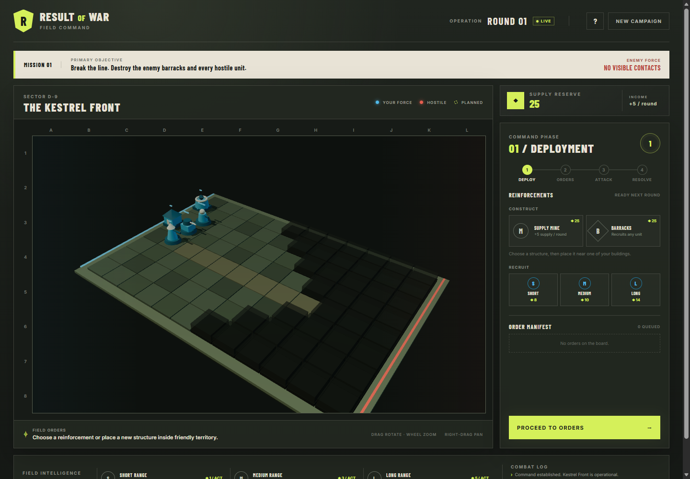

# Rule of War

A browser-based 3D real-time strategy game built with Three.js. Command against
the Iron Front AI or play a server-authoritative two-player campaign, build a
supply economy, recruit specialized units, capture command posts, and destroy
hostile command capability.

For file responsibilities and extension points, see [MODDING.md](MODDING.md).



## Run locally

```bash
npm install
npm start
```

Open `http://127.0.0.1:4173`.

Quality checks:

```bash
npm test
npm run check
npm run benchmark:scale
```

## Real-time controls

- Left-click selects units and structures.
- Shift-click adjusts a selection; Shift-drag box-selects formations.
- Right-click terrain to move and right-click a hostile to focus fire.
- `A` selects attack-move and `M` selects move.
- Hold Shift while issuing moves to append waypoints.
- `E` enables automatic attack, `F` enables automatic retreat, and `H` holds
  fire while enemies are in range.
- `S` stops and clears active movement.
- `Ctrl` + `1`-`9` assigns control groups; `1`-`9` recalls them.
- Space toggles tactical pause in solo play.
- Left-drag rotates, right-drag pans, and the wheel zooms the camera.

## Simulation

- Gameplay runs in a deterministic fixed-step simulation at 20 ticks per
  second. Rendering interpolates unit transforms independently.
- Units follow weighted terrain paths continuously, steer around formations,
  repath around obstructions, acquire visible targets, and fire according to
  weapon windup and reload timing.
- Construction, recruitment, healing, mines, projectiles, fog, objectives, and
  victory advance continuously.
- Mines generate supply per minute. Buildings and recruits use timed production
  queues.
- Movement, attacks, and unit behaviors have no action cost or upkeep.
- Capture every command post and hold the network for 30 seconds, or destroy
  all hostile units and barracks.
- Large maps retain virtualized terrain chunks, streamed detail, fog textures,
  deterministic elevation, rivers, water, bridges, and sparse terrain changes.

## Human multiplayer

Choose **VS Human**, create a campaign, and share the six-character match code.
The second player joins from the same server address.

The Node server validates ownership, command types, targets, and map bounds,
runs the authoritative simulation, and broadcasts state snapshots. Match state
is persisted in SQLite at `.data/rule-of-war.sqlite`; browser storage retains
resume references and tokens.

The match pauses if a player disconnects. Restart with `npm start` and use the
saved operation to reconnect.

## World campaign

The persistent strategic map stores sector terrain seeds, ownership, supply,
objectives, battles, and sparse terrain modifications. A sector remains
supplied while it has a contiguous friendly route to its faction edge.

## Developer tools

Open the configurator with `F12`, `Ctrl` + `Shift` + `D`, or **DEV**. It controls
map dimensions, starting forces, supply, terrain diagnostics, fog, income, and
weapon ranges. Applying structural settings starts a new operation.
