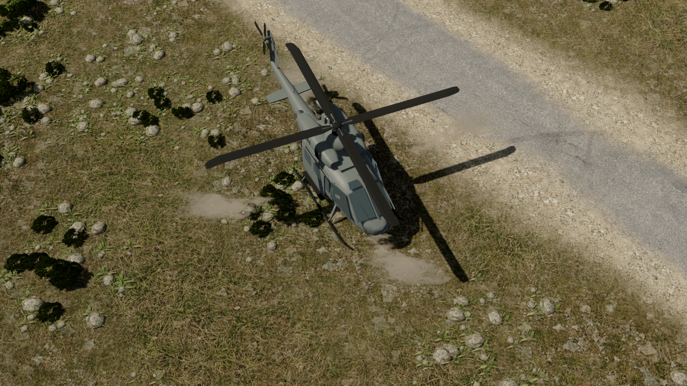

# UH-1Y Venom troop transport

The transport now uses a **UH-1Y Venom-inspired design**, researched from Bell,
NAVAIR and U.S. Marine Corps photographs. It replaces the original Vietnam-era
UH-1H appearance. The game retains **12 troop seats**, **24 supply**, the same
airfield/training purchases, fuel cycle and **L / right-click / U** controls.

The saved unit ID remains huey, so existing transports and their passengers
automatically receive the refined model. Its display name is **UH-1Y VENOM**.
Bell describes the real aircraft's seating as four crew plus eight passengers;
the game's twelve troop seats are the requested gameplay value.

## Refinement

- Rounded rectangular cabin, chined nose and separate cockpit/crew/cargo panes.
- Twin engine housings, recessed side intakes, exhaust bores and cooling grilles.
- Four tapered composite main blades, articulated root grips and pitch links.
- Four-blade tail rotor mounted high on the swept fin.
- Nose FLIR turret with separate optical apertures; no transport weapons.
- Sliding-door panels, tracks, handles, frame seams, vents and small fasteners.
- Tubular skids with curved toes, canted supports and side boarding steps.
- Wire cutters, antennas, flare-dispenser grilles, sensors and navigation lights.
- Subdued faction paint, darker door panels, dark composite blades and satin
  fittings. The modern model avoids the heavily chipped ground-vehicle albedos.

Geometry is defined in native/src/huey_models.rs. Materials are assigned in
native/src/scene.rs; all other aircraft retain their existing materials.
The existing main- and tail-rotor joints animate the new blade assemblies.

## Research and new photographs

Checked 29 October 2026.

- [Bell UH-1Y Venom](https://www.bellflight.com/products/bell-uh-1y):
  modern utility-helicopter design and actual seating configuration.
- [NAVAIR UH-1Y Venom](https://www.navair.navy.mil/product/UH-1Y-Venom):
  official aircraft and mission reference.
- [Bell H-1 design history](https://www.bellflight.com/post/h1-at-70):
  four-blade rotors, upgraded engines, cockpit and sensors.
- references/venom/uh1y-flight-2017.jpg — U.S. Marine Corps, Cpl. Hailey D.
  Clay, 9 November 2017; DVIDS 4101311.
  [Source and public-domain record](https://commons.wikimedia.org/wiki/File:UH-1Y_Venom.jpg).
  Used for the engine/gearbox profile, four-blade assemblies, cabin and nose.
- references/venom/uh1y-loading-2026.jpg — U.S. Marine Corps, Cpl. Maksim
  Masloboev, 11 June 2026; VIRIN 260611-M-JR395-1041, DVIDS 9777692.
  [Source and public-domain record](https://commons.wikimedia.org/wiki/File:31st_MEU_-_UH-1Y_Venom_flight_operations_(9777692).jpg).
  Used for the front-quarter silhouette, boarding doors, sensors and skid tubes.

The two reference photographs are identified as public-domain U.S. government
works on their source pages. They are modelling references; official insignia,
people and photographed weapons are not reproduced on the game model.
Hashes are recorded in references/venom/manifest.json.

## Earlier Huey references

The original UH-1H reference photographs remain available as historical sources:

- references/uh1h-side-1971.jpg — U.S. Air Force, August 1971, NARA 542344.
  [Source](https://commons.wikimedia.org/wiki/File:UH-1H_VNAF_in_flight_1971.jpg).
- references/uh1h-nasa-2011.jpg — NASA / George Homich, 17 August 2011.
  [Source](https://commons.wikimedia.org/wiki/File:NASA_Langley%27s_Bell_UH-1H_Huey.jpg).
- references/uh1d-landing-1966.jpg — U.S. Air Force, October 1966, NARA 542300.
  [Source](https://commons.wikimedia.org/wiki/File:US_soldier_directs_UH-1_to_land_Vietnam_1966.jpg).

## Verification

The transport regression checks twelve-seat limits, targeted pickup, landing
before unloading, save/load, cancelled drop-off, refuelling and shared helipads.
The aircraft geometry regression checks finite vertices, normals, nondegenerate
faces and parking bounds. Existing Huey smoke flags remain compatible.

Use tools/check_huey.py for loaded, unloaded, airborne, enemy and quality captures.
The new review images and report are saved under .data/render-checks/venom/.

