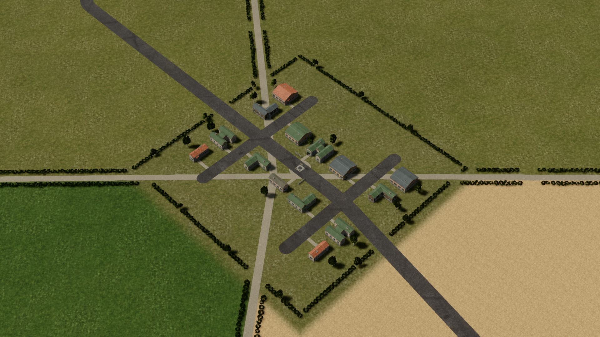
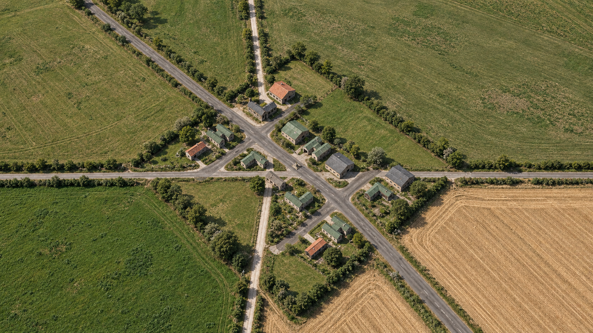

# Ground realism comparison and implementation plan

The battlefield needs land-use patterns, convincing surface transitions and environmental context to read as a real countryside settlement. Increasing texture resolution alone will preserve much of its current miniature appearance. The highest-value starting point is one representative village and its adjoining pasture and harvested field, seen through the existing gameplay camera.

This review compares the supplied screenshot with an AI-generated photographic target. The target keeps the broad viewpoint and settlement arrangement but changes road widths, spacing and small details. It is an art-direction reference, not a measured photograph, exact geometry specification or demonstrated engine result. No gameplay or rendering code was changed for this review.

## Reference images

### Supplied game view

### Photographic appearance target

The target was created with the built-in image-generation tool using the screenshot as its edit target. The complete prompt is in [generation-prompt.txt](generation-prompt.txt).

## Element comparison

| Element | What the screenshot communicates | What the target adds | Proposed game change |
| --- | --- | --- | --- |
| Ground at field scale | Large areas of similar mottled green or tan; changes mainly identify polygons. | Broader growth and moisture differences, distinct grazing and harvesting histories. | Give each parcel a land-use description, working direction and coherent broad condition masks. Connect variation to slopes, drainage, access and boundaries. |
| Ground at intermediate scale | Fine speckles dominate; most green areas have similar texture character. | Meadow clumps, worn strips, exposed earth and directional harvesting patterns. | Make pasture, cut grass, standing crop and stubble different surface families. Tune their contrast and physical feature size at the actual gameplay zoom. |
| Fine detail and repetition | The ground reads as a continuous carpet. A single still cannot establish how much is literal periodic tiling versus similar repeated features. | Detail sits beneath larger patterns and does not dominate the entire scene. | Audit source textures, physical repeat scale, mip levels and the existing anti-repetition blend. Preserve alignment between colour, normals and roughness. More random noise is not the objective. |
| Crop and vehicle marks | Field operations are hard to read in the screenshot. | Paired wheel tracks, headlands and stubble follow the field's working direction. | Make persistent agricultural marks separate from live vehicle wear. Let larger headlands and tramlines remain readable when fine crop rows are filtered out. Avoid aliasing narrow stripes. |
| Field boundaries | Geometry and colour meet in clean lines with thin hedges. | Uncultivated margins, hedge banks, shallow ditches, worn gate approaches and layered vegetation. | Add consistent boundary zones driven by the existing field polygons. Straight agricultural boundaries can remain straight; their surface construction needs depth and variation. |
| Roads and junctions | Uniform dark ribbons, crisp shoulders and rounded spur ends read as graphic shapes. | Aggregate variation, repairs, constructed junction corners, dirt shoulders and differentiated road types. | Audit main-road, lane and track widths in world metres. Preserve vehicle clearance. Improve junction surfaces and connect spur ends to believable yards or turning areas. Add restrained wear and verge blending. |
| Houses and yards | Small repeated structures sit directly on a common grass surface, with narrow clean paths. | Gravel courts, gardens, thresholds, boundary vegetation and signs of regular access. | Create per-lot ground masks and a small reusable set of yards, drives and gardens. Every entrance should connect to a lane or yard. Keep unit access and garrison doors clear. |
| Building materials | Roof and wall responses are similar across repeated building forms. | Variation in weathering, roof tone, eaves and wall contact with the ground. | Use restrained per-building material variants and local dirt or moisture masks. Judge the silhouette and roof scale before spending memory on finer textures. |
| Hedgerows and trees | Small dark, evenly spaced crowns make boundaries resemble strings of beads. | Overlapping volumes, varied crown heights, occasional taller growth and softer internal lighting. | Build a few representative hedge modules with broad growth variation and dense bases. Match leaf colour, skylight response and contact shading. Use representative cluster impostors at distance once the source hedge looks convincing. |
| Terrain shape | There are few readable changes in ground plane or slope at this view. | Subtle changes of relief and drainage reinforce the surface patterns. | Assess terrain normals and height under neutral materials. Add only modest, coherent local relief where appropriate. Keep foundations, roads and authoritative movement terrain aligned. |
| Lighting | Shadowed vegetation is very dark while the open field has a relatively uniform response. | Open skylight in foliage, plausible contact darkening and larger-scale changes in surface illumination. | Calibrate sun, sky, exposure and material values together. Use targeted static indirect light or occlusion where it helps. Preserve dynamic lighting for units, effects and changing structures. |
| Camera and image treatment | Narrow perspective and repeated similarly sized assets encourage a miniature reading. | Similar elevated framing supports realism once environmental cues improve. | Keep the existing camera for the first comparisons. Later test a modestly wider FOV against the same framing. Keep the image in focus; tilt-shift blur would strengthen the miniature effect. |

## What already exists in the renderer

The next pass should strengthen and coordinate existing systems before introducing parallel replacements.

- `native/src/grass_blend.wgsl` already blends three offset PBR samples to reduce repetition, then transitions to a cheaper filtered sample at distance. Whether that transition is visible needs an in-engine A/B at the supplied zoom; it cannot be diagnosed from the screenshot alone.
- The same shader already applies broad fertility variation, field tinting, planted rows, tramlines and headlands. Their visibility depends on pixel footprint, and several amplitudes are subtle. These cues need checking at overview and tactical zoom, not simply adding again.
- `native/src/rural_layout.rs` currently describes a field with four corners and two booleans, `crop` and `harvested`. Richer field identity, working direction and condition data would provide a stronger basis than additional global noise.
- `native/src/rural_surfaces.rs` already creates continuous road geometry. The visible improvement should come from junction construction, surfaces and shoulders while retaining a common road definition for movement and scenery.
- `native/src/ground_detail.rs` already provides measured relief and live vehicle wear. Agricultural history should complement that system rather than replace it.
- `native/src/scenery.rs` and `native/src/natural_geometry.rs` already provide vegetation tiers and natural mesh variation. Hedge massing and placement remain important even with improved individual shrubs.
- `native/src/fixed_view.rs` uses a real perspective camera with a 25-degree FOV and a fixed direction. It is not an orthographic projection. Its viewing direction is approximately 50 degrees down from horizontal.
- `native/src/lighting.rs` already controls sun, skylight, fill and grading. Lighting changes must remain consistent with the authored explosion lighting.

## Implementation order

### 1 Establish a reproducible baseline

Capture the current executable on a fresh battlefield and on the relevant save, matching the supplied camera, zoom and graphics settings. The screenshot may preserve an earlier layout or saved state; verify which current features it actually displays. Lock camera, sun, exposure and resolution for all subsequent A/B captures.

Capture the ordinary scene plus neutral-material, albedo and normal views where practical. Use these to separate lighting problems, exaggerated source contrast, geometry and texture repetition. Include overview, tactical and close views. Calibrate questionable material values before treating them as an art asset problem.

### 2 Prove the ground treatment in one small area

Use the village's adjoining green pasture and tan harvested field. Give the two parcels different source appearance and persistent land-use masks. Organize the surface at three scales: broad growth or moisture regions, intermediate clumps and field operations, and fine material grain.

Keep the current anti-repetition machinery initially. Audit its distance transition, texture means, repeat distances and the contrast of source clumps. Investigate the existing strong green field tint and the use of a soil-like layer for harvested parcels. A harvest should read through stubble and operations, not tan colour alone.

Generate or paint low-resolution parcel masks offline for stable patterns, then combine them with existing tiled PBR materials. Align normals and roughness with colour detail. Introduce physical surface relief only where it will remain visible. Stop and compare this patch before propagating it across the map.

Success: pasture and harvest can be identified from surface structure at ordinary zoom, their larger patterns survive zooming out, and detailed grain does not resemble repeating carpet or sparkle while panning.

### 3 Integrate roads and buildings into the ground

Add verge, soil, gravel and wear transitions around the same patch. Make entrances, field gates and access lanes connect naturally. Refine junction corners and spur destinations. Create a few per-lot yard and garden variants with matching threshold wear and grounded building bases.

Check road widths against actual vehicle dimensions and passing requirements before narrowing anything to resemble the generated target. Keep decorative geometry and grass clear of doors, road corridors and capture areas.

Success: roads feel constructed into land, houses have believable access and surroundings, and nothing appears placed on top of a flat green sheet.

### 4 Refine vegetation and environmental lighting

Replace the regular hedge silhouette with overlapping groups, varied heights and continuous bases. Retain deliberate gates and openings. Tune leaf and bark materials under the fixed light, including skylight and restrained transmission or subsurface response where supported. Keep contact shade local rather than making entire shrubs black.

Evaluate baked static indirect lighting or local occlusion after these shapes are settled. If direct shadows are baked, isolate mutable structures so destruction and roof removal do not leave stale shadows. Keep dynamic units and effects matched to the static scene's illumination. Avoid baking the same lighting contribution into colour and then applying it again at runtime.

Success: hedges read as living boundaries rather than repeated objects, shadowed foliage retains structure, and buildings, ground and moving units share a consistent light environment.

### 5 Optimize the proven appearance and test the camera

Create impostors or simplified meshes from approved vegetation and static scenery. Switch by projected screen size with stable transitions. Stream masks and textures in existing terrain/scenery chunks. Retain the reduced shadow budgets; only raise shadow detail if a controlled comparison demonstrates a specific visual need.

After the environmental pass, compare the current 25-degree FOV with a modest wider-FOV test while keeping the village similarly framed. Judge ordinary panning, zooming and gameplay readability. A larger environment redesign or camera change is justified only if the improved assets still show an obvious scale problem.

Success: the scene retains its appearance at all supported zooms without visible chunk changes, texture shimmer, obvious impostor swaps or excessive frame-time and memory growth. Record measured cost before claiming a performance improvement.

## Review criteria

Use matched images at the original zoom and inspect enlarged crops of the ground, one junction, one hedge and one house base. Check colour and grayscale views. Also watch slow pans: a still image can hide shimmering, LOD changes and repeated patterns.

The desired result is a landscape that initially reads like an aerial photograph while remaining clear enough to play. That is the intended meaning of approaching photorealism here, rather than adding blur or post-processing to hide a miniature scene.

Approve the small representative area before applying its settings across the battlefield. Preserve vehicle clearance, garrison access, roof reveal, destruction, fog visibility and camera navigation during any later implementation.

## Technical references

- [NVIDIA GPU Gems: Texture Bombing](https://developer.nvidia.com/gpugems/gpugems/part-iii-materials/chapter-20-texture-bombing) explains reducing regular repetition when texture detail covers large areas. The game already has a related sampling strategy; this is background for its audit, not a reason to add another sampling layer by default.
- [Epic: Landscape Materials](https://dev.epicgames.com/documentation/en-us/unreal-engine/landscape-materials-in-unreal-engine) describes layered materials and height-based transitions, including dirt appearing between rocks. The blending principles are relevant; the implementation here would remain in Bevy.
